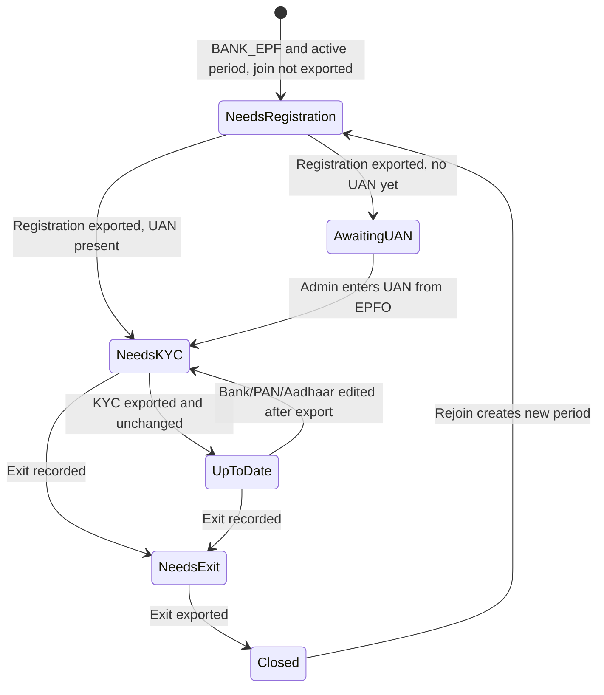

# Design: EPFO Member Compliance Hub

**Date:** 2026-11-10 · **Status:** Draft v3 (reviewed, awaiting approval)
**Scope:** Member management for EPF staff: New Member Registration, Mark Exit, and KYC Seed bulk files, with tracking of what has been exported.

---

## 1. Why

EPFO has no API for employers. Each change to a member has to be uploaded to the Unified Employer Portal as a `#~#`-delimited `.txt` file, then approved there with OTP/DSC. The school already generates the monthly ECR file. What's missing is the **member lifecycle**: registering new joiners, marking leavers, and seeding KYC. Today that happens by hand on the portal, and nothing in our app shows which staff are still pending at EPFO.

**Success:** The admin opens one screen and sees every EPF staff member's next EPFO action (register, mark exit, seed KYC, or nothing pending). They fix any missing data in place, download a file the portal accepts the first time, and the app remembers what was sent.

### What exists today (verified in code)

| Area | Current state |
|---|---|
| ECR | `ecr-text` / `ecr-final` in `src/app/api/payroll/export/[type]/route.ts`, buttons on `/payroll/monthly` |
| Bulk registration | A `bulk-reg` branch exists in the same route but **no UI calls it**. It is driven by `MonthlyPayroll`, so new joiners with no payroll row can't be exported. It also emits raw values (`Male`, `Father`) that EPFO rejects. |
| EPF membership | `StaffPayrollInfo.payGroup`: `BANK_EPF` = EPF member, `CASH` = exempt. History is kept in `PayGroupChange` (`effectiveFromMonth`). |
| EPFO fields in schema | All registration fields exist on `StaffPayrollInfo`. |
| EPFO fields in UI | **Missing:** `maritalStatus`, `nameOnAadhaar`, `nameOnPan`, `previousMemberId`, passport and disability fields have no edit UI anywhere. `nameOnUan` can only be edited in `/payroll/staff`. |
| Stored value formats | gender: `Male / Female / Other`. relationship: `Father / Husband / Mother / Other`. exitReason (UI): `RESIGNATION / END_OF_CONTRACT / RETIREMENT / TERMINATION / OTHER`. Legacy values in tests and the schema comment: `RESIGNED / TERMINATED / RETIRED`. |
| Lifecycle | `EmploymentPeriod` (`startDate`, `endDate`, `exitReason`). Staff can **rejoin**, which creates a new period. |
| Auth / audit | `requireRole(session, ['ADMIN'])`, `AuditLog` model (`action`, `targetType`, `details` JSON) |

---

## 2. Goals / Non-goals / Anti-goals

**Goals**
1. A second tab, **EPFO Members**, on `/payroll/staff` (selected Approach A).
2. A per-member **Next EPFO action** with a readiness check scoped to that action.
3. Three exports: Registration, Mark Exit, KYC Seed.
4. Persistent tracking of what was exported. Exported members leave the pending queues automatically, with an undo option.
5. In-place data fixing, including the EPFO fields that have no UI today.
6. A simple way to enter the UAN that EPFO generates after registration.

**Non-goals**
- Automated portal submission or scraping. EPFO blocks this with CAPTCHA, OTP and DSC.
- Changes to the ECR file or to payroll calculations.
- Parsing EPFO's response or acknowledgement files (possible later).

**Anti-goals**
- Generating a file the portal will reject without telling the admin first.
- A second, separate "member" table. Use `Staff`, `StaffPayrollInfo` and `EmploymentPeriod`.
- Editing a leaver's last working day from the export dialog. That date drives attendance and payroll, so it's only changed through the existing staff exit flow.

---

## 3. Approaches (decided)

- **A. Dual tab on `/payroll/staff` (chosen):** "Salary & Pay Groups" (current table) and "EPFO Members" (compliance view). This keeps statutory columns out of the salary table and shares the page's data fetch.
- **B. Single table with a compliance-mode toggle (rejected):** columns shift around, sorting and pagination get complicated, and it works badly on mobile.
- *Earlier options also rejected:* a standalone `/payroll/epfo` page (the user preferred to keep it in Salary Setup), and a third pay group `BANK_NO_EPF` (the user chose to keep `BANK_EPF` = EPF member).

---

## 4. Member lifecycle and "Next action"



Computed per staff member by `getEpfoNextAction()`. The first matching rule wins:

| Next action | Rule |
|---|---|
| `NEEDS_EXIT` | Latest period has an `endDate` **and** `epfoJoinExportedAt` is set (they were registered) **and** `epfoExitExportedAt` is null |
| `NEEDS_REGISTRATION` | Active period, `BANK_EPF`, `epfoJoinExportedAt` is null. **This includes people who already have a UAN**: they still have to be linked to our establishment. |
| `AWAITING_UAN` | Join exported, `uan` empty |
| `NEEDS_KYC` | UAN present and (`epfoKycExportedAt` is null **or** the current KYC fingerprint ≠ `epfoKycExportedHash`) |
| `UP_TO_DATE` | Otherwise |
| *(hidden)* | `CASH` with no EPF history, or exited and never registered |

**The readiness badge validates only the row's next action.** This fixes the earlier design, where an active employee could never be "Ready" because exit fields were also being checked.

**Tracking lives on the employment period, not on the staff record.** A rejoin needs a fresh registration and a fresh exit, so timestamps on `StaffPayrollInfo` would wrongly say "already done".

---

## 5. Data model changes

```prisma
model EmploymentPeriod {
  // ...existing
  epfoJoinExportedAt  DateTime?
  epfoExitExportedAt  DateTime?
  epfoExitCode        String?   // C|S|R|D|A|P, chosen at export; internal exitReason is left unchanged
}

model StaffPayrollInfo {
  // ...existing
  epfoKycExportedAt   DateTime?
  epfoKycExportedHash String?   // sha256 of the normalised exported KYC values; a mismatch means "changed since export"
}
```

Additive and nullable only. No backfill: existing staff start as pending. To avoid a flood of false "pending" rows, there is a one-time **"Mark as already filed on EPFO"** bulk action (§7).

---

## 6. File formats

> [!IMPORTANT]
> EPFO revises its templates. All column layouts live in one module, `src/lib/epfo/formats.ts`, as ordered column definitions. **Before go-live, the admin downloads the current sample file from the Unified Portal and we check our output against it.** That check is a step in the implementation plan.

**Rules for every file:** plain ASCII `.txt`, `#~#` delimiter, one record per line separated by `\n`, **no trailing blank line**. Values are trimmed, have `#`, `~` and line breaks removed, and names are uppercased with titles (Mr/Mrs/Dr) dropped. Dates are `DD/MM/YYYY`. Filenames: `EPFO_REG_YYYYMMDD_HHmm.txt`, `EPFO_EXIT_…`, `EPFO_KYC_…`.

### 6.1 New Member Registration (30 columns)
Keep the existing 30-column order from the current `bulk-reg` code, but build it from `Staff` + `StaffPayrollInfo` + the current `EmploymentPeriod` (**not** `MonthlyPayroll`), with these mappings:

| Column | Source → EPFO value |
|---|---|
| 1 UAN | `uan` if present, else blank (EPFO generates one) |
| 3 Name | `nameOnUan` if UAN present, else `nameOnAadhaar`, else `name` |
| 5 DOJ | **EPF join date** = later of (current period `startDate`, first day of the `effectiveFromMonth` of the latest `PayGroupChange` to `BANK_EPF`). This handles staff moved from CASH to EPF. |
| 6 Gender | `Male→M`, `Female→F`, `Other→T` |
| 8 Relationship | `Father→F`, `Husband→H`. `Mother`/`Other` is a **blocking error** (EPFO accepts only F/H). |
| 12 Wages | `calculateStaffPayroll({ payGroup: 'BANK_EPF', monthlyCtc, presentDays: 30, totalDays: 30 }).epfWages`, i.e. the existing engine at full attendance with no bonus (= CTC ÷ 1.12, rounded). Call the existing function; no new wage formula. Any future change to PF wage rules then flows through to ECR and registration together. |
| 14 Marital | `M / U / W / D` |
| 13, 15–23 | Existing defaults (`N`, `INDIA`, etc.) |

### 6.2 Mark Exit (3 columns). *Corrected: the earlier draft had an extra empty Member-ID column.*
`UAN#~#DATE_OF_EXIT#~#REASON_CODE` → e.g. `100248330106#~#31/03/2026#~#C`

Codes: `C` Cessation (short service), `S` Superannuation, `R` Retirement, `D` Death in service, `A` Death away from service, `P` Permanent disablement.

Default mapping (can be changed per row in the export dialog; stored in `epfoExitCode`):

| Internal `exitReason` | Default code |
|---|---|
| RESIGNATION, RESIGNED, TERMINATION, TERMINATED, END_OF_CONTRACT, OTHER | `C` |
| RETIREMENT, RETIRED | `S` if age ≥ 58 on the exit date, else `R` |

Validation: UAN must be 12 digits, exit date ≥ EPF join date. **Warning (non-blocking):** payroll for the exit month isn't locked yet. EPFO expects the ECR for the last month to be filed before the exit is marked.

### 6.3 KYC Seed (5 columns). *Corrected: the earlier draft had 6 columns with an expiry field.*
`UAN#~#DOC_TYPE#~#DOC_NUMBER#~#NAME_AS_PER_DOC#~#IFSC`

| Type | Line | Validation |
|---|---|---|
| `B` Bank | `UAN#~#B#~#ACCOUNT#~#NAME_AS_PER_BANK#~#IFSC` | IFSC `^[A-Z]{4}0[A-Z0-9]{6}$`, account 9–18 digits |
| `P` PAN | `UAN#~#P#~#PAN#~#NAME_ON_PAN#~#` | `^[A-Z]{5}[0-9]{4}[A-Z]$` |
| `A` Aadhaar | `UAN#~#A#~#AADHAAR#~#NAME_ON_AADHAAR#~#` | 12 digits, not starting with 0 or 1 |

**Partial documents:** a line is written for every selected document type that is valid. Missing or invalid ones are skipped and listed in the pre-export summary. They never produce an empty placeholder line.

---

## 7. UI

Follows the existing `@/components/ui` kit and tokens. Icons are Lucide only (no emoji). Badge colours use the existing `tone-present / tone-accent / tone-absent` classes. The tab is kept in the URL (`/payroll/staff?tab=epfo`) so it can be bookmarked.

```
Staff Payroll Setup
[ Salary & Pay Groups ]  [ EPFO Members  (7 pending) ]
─────────────────────────────────────────────────────────────────
Queue: (Needs registration 3) (Awaiting UAN 1) (Needs exit 2) (KYC pending 1) (Up to date 24) (All EPF)
Search…                                       [Mark as already filed ▾]
─────────────────────────────────────────────────────────────────
[■] Name / Code        UAN             Next action        Readiness
[■] Priya Sharma S012  —               Register           ⚠ 2 missing  [Fix]
[■] Ramesh Kumar S004  1001xxxx4512    Register (link)    ✓ Ready
[ ] Anil Verma  S020   — [enter UAN]   Awaiting UAN       —
─────────────────────────────────────────────────────────────────
Sticky footer when rows are selected:
  3 selected · 2 ready   [Download registration file]
```

- **Queue chips** replace the filter presets. The primary action button matches the active queue (Register / Mark exit / Seed KYC), so you can never export the wrong file type for a selection.
- **Readiness:** ✓ Ready, or ⚠ N missing. The popover lists the exact fields; **Fix** opens `StaffProfileModal` on the Statutory tab with those fields highlighted.
- **Pre-export summary dialog** (all three types): "Exporting 8 · Skipping 2 (reasons)". Confirming downloads the file and marks the exported rows.
- **Mark Exit dialog:** each row shows the last working day (read-only, with a link to the staff profile) and an editable reason-code select pre-filled from §6.2, plus the unlocked-payroll warning.
- **Awaiting UAN:** an inline 12-digit UAN input on the row, saved through the existing `PUT /api/payroll/staff`.
- **After export:** a toast with **Undo** (clears the timestamps just set). The row menu also has "Reset to pending" for files EPFO rejects later.
- **Mark as already filed:** sets the relevant timestamp without generating a file (for onboarding existing members), with a confirmation dialog.
- **New edit fields** in `StaffProfileModal` → Statutory tab, "EPFO details" section: Name on UAN / Aadhaar / PAN, Marital status, Previous member ID. A collapsed "Additional EPFO fields" group holds the international worker, passport and disability fields.
- **Mobile:** the same queue chips with a card list (matching the existing mobile cards on this page), and the action footer pinned to the bottom.
- **Accessibility:** checkboxes have labels, badges show text as well as colour, and focus rings are visible.

---

## 8. Architecture

```
src/lib/epfo/
  formats.ts        column definitions + line builders (pure functions)
  mappings.ts       gender / relationship / marital / exit-code mapping
  validation.ts     validateFor(action, staff) -> { ready, errors: {field, message}[] }
  next-action.ts    getEpfoNextAction(staff, periods, payGroupChanges)
  kyc-hash.ts       normalised fingerprint of KYC values
src/app/api/payroll/epfo/
  members/route.ts           GET: EPF members with nextAction + readiness (server-computed)
  export/[type]/route.ts     POST: reg | exit | kyc
  mark/route.ts              POST: mark-as-filed / reset-to-pending
src/components/payroll/epfo/
  EpfoMembersTab.tsx, ExportSummaryDialog.tsx, MarkExitDialog.tsx
```

**Export route contract:** `POST { staffIds, exitCodes?: Record<staffId, code>, docTypes?: ('B'|'P'|'A')[] }`
1. `requireRole(['ADMIN'])`.
2. Reload the staff from the database and **re-validate on the server**. The client's readiness view is never trusted.
3. Build the file from valid rows only. If none are valid, return 422 with the errors.
4. In **one transaction**: set the timestamps, `epfoExitCode` and the KYC hash; write an `AuditLog` entry (`action: EPFO_EXPORT_REG|EXIT|KYC`, `details`: type, staffIds, skipped ids and reasons; **no Aadhaar/PAN/account values**).
5. Return the `.txt` with `Content-Disposition`, plus an `X-Epfo-Skipped` header (JSON count) for the toast.

**Legacy cleanup:** remove the unused `bulk-reg` branch from the payroll export route (and its test). Its logic moves into `formats.ts`, so there's one source of truth.

---

## 9. Testing

- Unit: each mapping, each validator rule, `getEpfoNextAction` for every state (including rejoin and CASH→EPF), and line builders against fixed expected strings (no trailing newline, sanitisation).
- Route: RBAC 403 for non-admins, server re-validation skips invalid rows, the transaction sets timestamps and the audit log, 422 when nothing is exportable, undo/reset.
- Manual go-live check: upload one file of each type to the EPFO portal and record the result in the plan.

---

## 10. Calls I made (please check)

1. Retirement maps to **S if age ≥ 58, else R**.
2. The exit dialog **can't edit the exit date**; only the reason code.
3. The unused `bulk-reg` export is **removed**, not kept alongside the new one.
4. Existing staff start as **pending**, and the admin uses "Mark as already filed" once to clear them.
5. ~~Registration wages~~ **Decided by user:** reuse the existing `calculateStaffPayroll` engine (`epfWages` at full attendance, no bonus). PF wage rules (gross vs basic + DA) are unchanged in this project.

## 11. Left to the builder
Component splitting, exact copy, and the test file layout.
